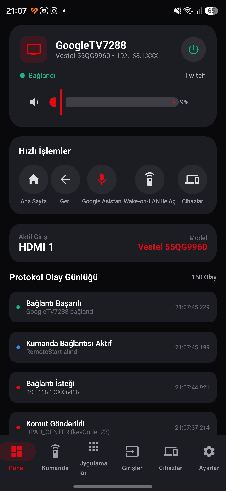
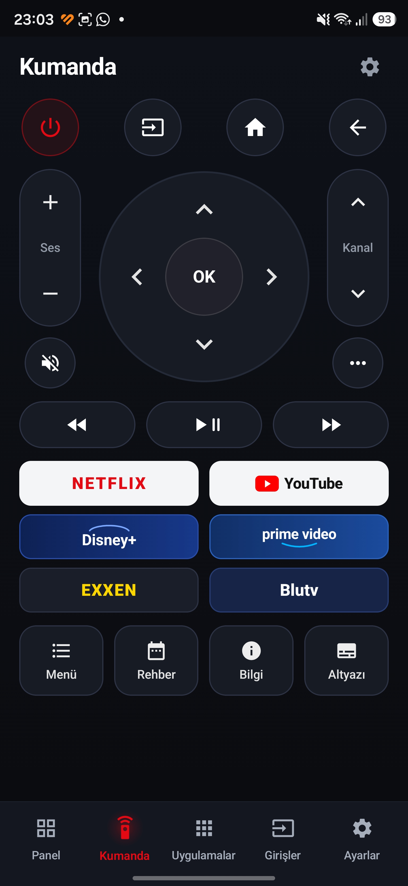
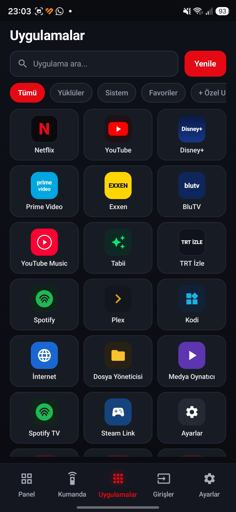
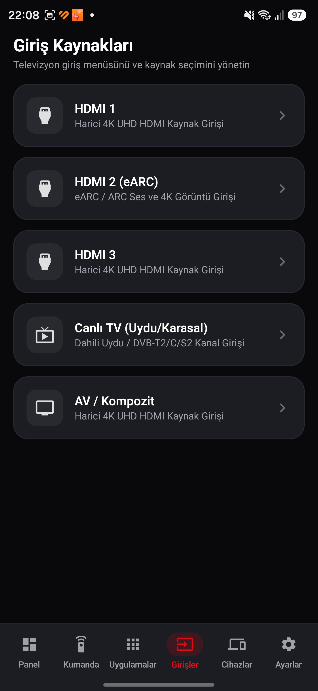
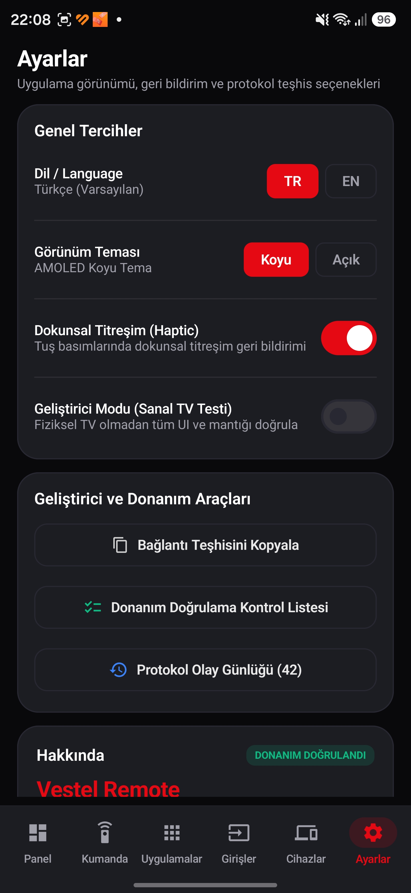
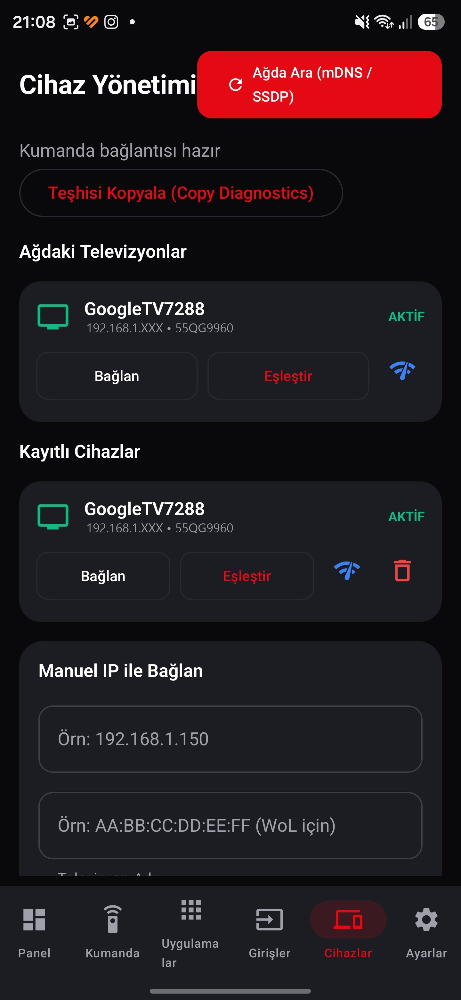
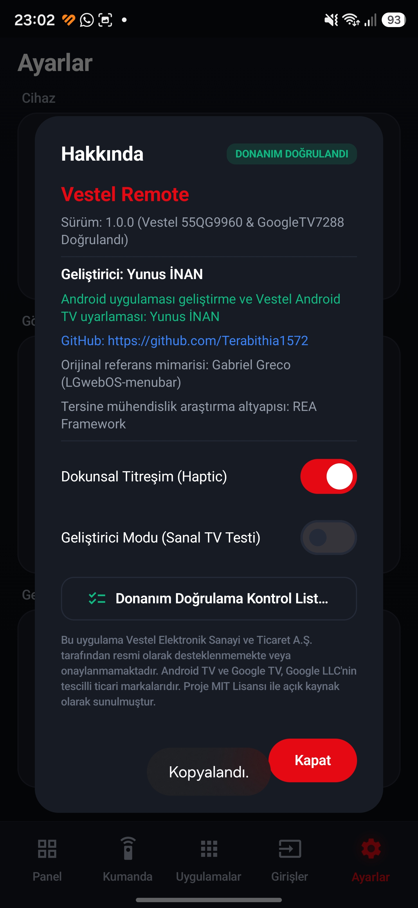

<div align="center">

# 📺 Vestel Remote — Android TV Akıllı Kumanda

**Vestel 55QG9960 4K QLED Android TV ve uyumlu Android TV / Google TV televizyonları yerel Wi-Fi ağı üzerinden kontrol etmek için geliştirilmiş, donanım üzerinde doğrulanmış yerel (native) Android uygulaması.**

[-3DDC84?logo=android&logoColor=white)](https://developer.android.com)
[](https://kotlinlang.org)
[](https://developer.android.com/jetpack/compose)
[](#4-desteklenen-ve-doğrulanan-donanım)
[-E30613)](#4-desteklenen-ve-doğrulanan-donanım)
[](https://github.com/Terabithia1572/Vestel-Remote-Android/releases)
[](LICENSE)

**Android uygulaması geliştirme ve Vestel Android TV uyarlaması: [Yunus İNAN](https://github.com/Terabithia1572)**  
Orijinal macOS menü çubuğu referans projesi: [LGwebOS-menubar — Gabriel Greco](https://github.com/gabrielgreco1/LGwebOS-menubar)

🌐 **Dil / Language:** **🇹🇷 Türkçe** | **[🇬🇧 English (README_EN.md)](README_EN.md)**

---

### 📱 Ana Kontrol Paneli (Samsung Galaxy S24 Ultra & Vestel 55QG9960 `GoogleTV7288`)



<p><sub><b>Ana Kontrol Paneli (Panel):</b> Aktif <code>GoogleTV7288</code> bağlantısı, kararlı ses kontrolü, hızlı işlemler, aktif giriş kaynağı ve canlı protokol günlüğü</sub></p>

### ✨ Yenilenen Arayüz Galerisi

<table>
  <tr>
    <td align="center" width="25%">
      <br/>
      <b>Kumanda</b><br/>
      <sub>Dairesel D-Pad, dikey ses/kanal mandalları ve medya kontrolleri</sub>
    </td>
    <td align="center" width="25%">
      <br/>
      <b>Uygulamalar</b><br/>
      <sub>DIAL (Port 8008) doğrulaması, hızlı başlatma ızgarası ve özel Deep Link</sub>
    </td>
    <td align="center" width="25%">
      <br/>
      <b>Girişler</b><br/>
      <sub>HDMI 1, HDMI 2 (eARC), HDMI 3, Canlı TV ve AV 2 sütunlu seçim ızgarası</sub>
    </td>
    <td align="center" width="25%">
      <br/>
      <b>Ayarlar</b><br/>
      <sub>Bölümlendirilmiş ayarlar, cihaz yönetimi, teşhis ve bağlantıyı kesme</sub>
    </td>
  </tr>
</table>

</div>

---

## 📋 İçindekiler

1. [Proje Tanıtımı](#1-proje-tanıtımı)
2. [Özellikler](#2-özellikler)
3. [Ekran Görüntüleri](#3-ekran-görüntüleri)
4. [Desteklenen ve Doğrulanan Donanım](#4-desteklenen-ve-doğrulanan-donanım)
5. [Kurulum](#5-kurulum)
6. [Eşleştirme Talimatları](#6-eşleştirme-talimatları)
7. [Uzaktan Kumanda İşlevleri](#7-uzaktan-kumanda-işlevleri)
8. [Uygulama Başlatıcı ve DIAL Keşfi](#8-uygulama-başlatıcı-ve-dial-keşfi)
9. [HDMI ve Giriş Kaynağı Kontrolleri](#9-hdmi-ve-giriş-kaynağı-kontrolleri)
10. [Ses Kontrolü Kararlılığı (Volume Stabilization)](#10-ses-kontrolü-kararlılığı-volume-stabilization)
11. [Teknik Mimari](#11-teknik-mimari)
12. [Android İzinleri](#12-android-izinleri)
13. [Güvenlik ve Gizlilik](#13-güvenlik-ve-gizlilik)
14. [Derleme Talimatları](#14-derleme-talimatları)
15. [Test Süreçleri](#15-test-süreçleri)
16. [Bilinen Sınırlamalar](#16-bilinen-sınırlamalar)
17. [Açık Kaynak Atıfları ve Teşekkür](#17-açık-kaynak-atıfları-ve-teşekkür)
18. [Lisans ve Geliştirici Bilgileri](#18-lisans-ve-geliştirici-bilgileri)

---

## 1. Proje Tanıtımı

**Vestel Remote**, **Vestel 55QG9960 4K QLED Android TV** başta olmak üzere Android TV Remote Service v2 protokolünü destekleyen televizyonları yerel Wi-Fi ağı üzerinden kontrol etmek amacıyla geliştirilmiş modern bir Android akıllı telefon uygulamasıdır.

Proje, Gabriel Greco'nun macOS/LG webOS için geliştirdiği [LGwebOS-menubar](https://github.com/gabrielgreco1/LGwebOS-menubar) projesinden ilham alınarak; tamamen **Kotlin**, **Jetpack Compose**, **Material 3** ve **Android TV Remote v2 (mTLS / Protobuf)** protokol altyapısıyla yerel Android platformu için yeniden tasarlanmış ve **Yunus İNAN** tarafından Vestel Android TV donanımına uyarlanmıştır.

Uygulama, **Samsung Galaxy S24 Ultra** üzerinde gerçek **Vestel 55QG9960 (`GoogleTV7288`)** televizyon ile eşleştirilerek uçtan uca donanım üzerinde doğrulanmıştır.

---

## 2. Özellikler

- **🖤 Premium AMOLED Karanlık Arayüz:** Derin siyah (`#06070B`) arka plan, kömür grisi yuvarlatılmış kartlar, ince kenarlıklar, Vestel kırmızısı (`#E5192A`) vurgu rengi ve tek satırlı **5 sekmeli alt gezinme çubuğu** (`Panel`, `Kumanda`, `Uygulamalar`, `Girişler`, `Ayarlar`).
- **🔍 Otomatik TV Keşfi (mDNS & SSDP):** Yerel ağdaki `_androidtvremote2._tcp` (Android TV Remote v2) ve SSDP/DIAL servislerini otomatik tarar; ayrıca manuel IPv4 ve MAC adresi girişini destekler.
- **🔐 PIN Doğrulamalı Karşılıklı TLS (mTLS) Eşleştirme:** Port `6467` üzerinden Android Keystore donanım destekli 2048-bit RSA istemci sertifikası ve televizyon ekranında beliren 6 karakterli HEX PIN kodu ile güvenli eşleştirme yapar.
- **📌 Sunucu Sertifikası Sabitleme (Certificate Pinning):** Eşleştirme sırasında alınan TV X.509 sertifikasının SHA-256 parmak izini kaydeder ve Port `6466` üzerindeki kumanda oturumlarında doğrular.
- **🏠 Ana Kontrol Paneli (`Panel`):** Bağlı televizyonun adını (`GoogleTV7288`), modelini (`Vestel 55QG9960`), güç düğmesini, kararlı ses kaydırıcısını (`-` / `+` ve `Sessiz`), 4'lü hızlı işlem ızgarasını (`Ana Sayfa`, `Geri`, `Asistan`, `TV Uyandır`), aktif giriş kartını ve zaman damgalı **Protokol Olay Günlüğü** akışını gösterir.
- **🎮 Ergonomik Uzaktan Kumanda (`Kumanda`):** Dairesel D-Pad, dikey ses/kanal mandalları, medya kontrol satırı ve dokunmatik yüzey, renk tuşları ile `0–9` numara takımını barındıran açılır `...` çekmecesi.
- **🚀 Hibrit Uygulama Başlatıcı (`Uygulamalar`):** DIAL (`Port 8008`) durum doğrulaması (`Açık` / `Kurulu`), özel **TVX (`com.tvx.tv`)** ve **RecTV (`com.rectv.shot`)** katalog entegrasyonu, `AppLauncherEngine` ile kanıt düzeyli Deep Link başlatma, arama/filtreleme, favoriler ve uygulama başlatma teşhisi.
- **🔌 Giriş Kaynakları (`Girişler`):** Aktif kaynak rozetli 2 sütunlu HDMI / Canlı TV / AV seçim kartları.
- **🩺 Bağlantı ve Uygulama Başlatma Teşhisi (`Ayarlar`):** Kişisel veri sızdırmadan bağlantı ve uygulama başlatma aşamalarını panoya kopyalama (`Tanılama Bilgilerini Kopyala`), Cihaz Yönetimi erişimi, dil/tema/titreşim tercihleri ve tek dokunuşla bağlantıyı kesme.

---

## 3. Ekran Görüntüleri

Aşağıdaki tüm ekran görüntüleri, **Vestel 55QG9960 (`GoogleTV7288`)** televizyona aktif olarak bağlı **Samsung Galaxy S24 Ultra** cihazından doğrudan alınmıştır (yerel ağ IP adresinin son okteti gizlilik amacıyla `192.168.1.XXX` olarak maskelenmiştir):

### Ana Gezinme Ekranları (5 Sekmeli Alt Çubuk)

<table>
  <tr>
    <td align="center" width="33%">
      <br/>
      <b>1. Panel (Dashboard)</b><br/>
      <sub>Canlı <code>GoogleTV7288</code> durumu, ses kontrolü, hızlı işlemler, aktif giriş ve protokol günlüğü</sub>
    </td>
    <td align="center" width="33%">
      <br/>
      <b>2. Kumanda (Remote)</b><br/>
      <sub>Dairesel D-Pad, dikey <code>SES</code> / <code>KANAL</code> mandalları, hızlı tuşlar ve medya kontrolleri</sub>
    </td>
    <td align="center" width="33%">
      <br/>
      <b>3. Uygulamalar (Applications)</b><br/>
      <sub>DIAL (Port 8008) doğrulanan uygulamalar, hızlı başlatma ızgarası ve özel Deep Link</sub>
    </td>
  </tr>
  <tr>
    <td align="center" width="33%">
      <br/>
      <b>4. Girişler (Inputs)</b><br/>
      <sub>Aktif kaynak rozetli HDMI 1, HDMI 2 (eARC), HDMI 3, Canlı TV ve AV ızgarası</sub>
    </td>
    <td align="center" width="33%">
      <br/>
      <b>5. Ayarlar (Settings)</b><br/>
      <sub>Cihazlar, Görünüm, Kumanda, Gelişmiş/Teşhis grupları ve bağlantıyı kesme</sub>
    </td>
    <td align="center" width="33%">
      <br/>
      <b>6. Cihazlar (Devices)</b><br/>
      <sub>mDNS / SSDP ağ taraması, kayıtlı <code>GoogleTV7288</code> kartı ve manuel IP girişi</sub>
    </td>
  </tr>
</table>

<details>
<summary><b>ℹ️ Ek Ekran Görüntüsü: Hakkında ve Açık Kaynak Bildirimleri (Görmek için tıklayın)</b></summary>
<br/>
<div align="center">
  <br/>
  <b>7. Hakkında (About)</b><br/>
  <sub>Uygulama sürümü, geliştirici atfı (Yunus İNAN) ve açık kaynak lisans bildirimleri</sub>
</div>
</details>

---

## 4. Desteklenen ve Doğrulanan Donanım

Bu sürüm (`v1.0.0-beta.3`), gerçek fiziksel donanımlar üzerinde uçtan uca test edilmiş ve doğrulanmıştır:

| Bileşen | Doğrulanan Cihaz / Model | Durum |
| :--- | :--- | :--- |
| **Akıllı Telefon** | **Samsung Galaxy S24 Ultra** (Dynamic AMOLED 2X, 1440×3120, One UI) | ✅ Doğrulandı |
| **Televizyon** | **Vestel 55QG9960 4K QLED Android TV** (Ağ adı: `GoogleTV7288`) | ✅ Doğrulandı |
| **Uyumlu Diğer Cihazlar** | `Android TV Remote Service v2` (`_androidtvremote2._tcp`) barındıran tüm Android TV / Google TV modelleri | ✅ Uyumlu |
| **Cihaz Keşfi & Eşleştirme** | Yerel Wi-Fi mDNS / SSDP keşfi ve Port `6467` mTLS 6 haneli PIN eşleştirmesi | ✅ Doğrulandı |
| **Canlı Kumanda & Ses / HDMI** | Port `6466` oturumu, D-Pad, kararlı ses kontrolü ve HDMI geçişleri | ✅ Doğrulandı |
| **TVX Uzaktan Başlatma (`com.tvx.tv`)** | Android TV Remote v2 `RemoteAppLinkLaunchRequest` (`tvx://`) ile fiziksel TV'de doğrudan açılış | ✅ Doğrulandı |
| **RecTV Katalog Entegrasyonu (`com.rectv.shot`)** | Uygulama kataloğuna eklendi; doğrudan başlatma desteklenmiyor (TV Ana Ekranı `HOME` yönlendirmesi) | ℹ️ Katalog + Yönlendirme |

---

## 5. Kurulum

### Yöntem 1: GitHub Releases Üzerinden Hazır APK Kurulumu
1. Bu deponun **[Releases](https://github.com/Terabithia1572/Vestel-Remote-Android/releases)** sayfasından en güncel `Vestel-Remote-v1.0.0-beta.3-debug.apk` dosyasını telefonunuza indirin.
2. Android telefonunuzda indirilen APK dosyasına dokunun ve gerekirse **"Bilinmeyen uygulamaları yükle"** iznini onaylayın.

### Yöntem 2: ADB (Android Debug Bridge) ile Kurulum
Telefonunuzda **USB Hata Ayıklama** açıkken bilgisayarınızdan şu komutu çalıştırın:
```powershell
adb install -r app\build\outputs\apk\debug\app-debug.apk
```

---

## 6. Eşleştirme Talimatları

1. **Aynı Wi-Fi Ağına Bağlanın:** Telefonunuz ile Vestel Android TV'nizin aynı yerel Wi-Fi ağında olduğundan emin olun.
2. **Televizyonu Açık Tutun:** Televizyonu fiziksel kumandasıyla açın.
3. **Cihaz Yönetimi Ekranını Açın:** Üst başlıktaki durum rozetine dokunarak veya **Ayarlar → Cihaz Yönetimi** satırından **Cihazlar** ekranına geçin (*Ayarlar → Geliştirici / Sanal TV Modu* seçeneğinin kapalı olduğundan emin olun).
4. **Televizyonu Tarayın:** **"Ağda Ara (mDNS / SSDP)"** düğmesine dokunun. Televizyonunuz (ör. `GoogleTV7288`) listede belirecektir. Ağınız multicast paketlerini kısıtlıyorsa **Manuel IP ile Bağlan** bölümünden televizyonun IPv4 adresini girin.
5. **PIN ile Eşleştirin:** Cihaz kartındaki **"Eşleştir"** düğmesine dokunun ve televizyon ekranında beliren 6 karakterli HEX PIN kodunu telefondaki pencereye girip **Onayla** düğmesine basın.
6. **Kontrole Başlayın:** Bağlantı durumu **Bağlı** olarak güncellendiğinde tüm sekmelerden televizyonunuzu kontrol edebilirsiniz. Sonraki açılışlarda PIN girmeye gerek kalmadan sabitlenmiş (pinned) sertifika ile doğrudan bağlanılır.

---

## 7. Uzaktan Kumanda İşlevleri

**Kumanda** ekranı, tek elle kullanım ergonomisi için yeniden tasarlanmıştır:

- **Üst Yardımcı Satır:** `Giriş` (Source), `Asistan` (Google Assistant), `...` (Ek Kontroller Çekmecesi) ve kırmızı `Güç` (Power) tuşları.
- **Merkezi Navigasyon Alanı:**
  - **Sol Dikey Mandal (`SES`):** Dokunsal geri bildirimli `SES +` ve `SES -` kontrolü.
  - **Dairesel D-Pad:** Koyu halka üzerinde Yukarı, Aşağı, Sol, Sağ yön tuşları ve merkezde yükseltilmiş **`OK`** düğmesi.
  - **Sağ Dikey Mandal (`KANAL`):** `KANAL +` ve `KANAL -` kontrolü.
- **Hızlı Gezinme Satırı:** `Geri`, `Ana Sayfa`, `Sessiz` ve `Menü` hap düğmeleri.
- **Medya Oynatma Kartı:** `Geri Sar`, kırmızı vurgulu `Oynat / Duraklat` ve `İleri Sar` kontrolleri.
- **Açılır `...` Çekmecesi:** Ana ekranı kalabalıklaştırmadan **Dokunmatik Yüzey (Touchpad)**, **HbbTV Renk Tuşları** (Kırmızı, Yeşil, Sarı, Mavi), **Bilgi / Altyazı** ve **`0–9` Sayısal Kanal Tuş Takımı** erişimi sunar.

---

## 8. Uygulama Başlatıcı ve DIAL Keşfi

**Uygulamalar** ekranı, Android TV protokollerinin yeteneklerini şeffaf biçimde birleştirir ve kurulum keşfi ile uzaktan başlatma kanıt düzeylerini açıkça ayırır:

1. **TV'de Doğrulanan Uygulamalar (DIAL — Port `8008`):**
   - Televizyonun yerel DIAL REST sunucusunu (`http://<TV_IP>:8008/apps/<AppName>`) sorgulayarak **YouTube** ve **Netflix** gibi DIAL destekli uygulamaların televizyonda kurulu olup olmadığını ve anlık çalışma durumunu (`Açık` / `Kurulu`) doğrular.
   > **Protokol Notu:** Standart Android TV Remote v2 (`Port 6466`) ve DIAL (`Port 8008`) protokolleri, televizyonda ADB (Android Debug Bridge) geliştirici modu açılmadığı sürece işletim sistemindeki tüm yüklü APK paketlerinin tam listesini dışarıya vermez.
2. **Özel Android TV Uygulamaları (TVX & RecTV Entegrasyonu):**
   - Kullanıcı tarafından televizyonda kurulu olduğu onaylanan uygulamalar DIAL doğrulaması taklit edilmeden **`TV'de Yüklü (Kullanıcı Onaylı)`** olarak işaretlenir ve kendi özel Jetpack Compose vektör ikonlarıyla 3 sütunlu uygulama ızgarasında yer alır:
   - **TVX (`com.tvx.tv`):**
     - **Görünen Ad:** `TVX`
     - **Paket Adı:** `com.tvx.tv`
     - **Deep Link:** `tvx://` (`com.tvx.tv.MainActivity` üzerinde `ACTION_VIEW` + `CATEGORY_BROWSABLE` olarak doğrulanmıştır)
     - **Başlatma Yöntemi:** Android TV Remote v2 `RemoteAppLinkLaunchRequest` (Protobuf Alan `90`)
     - **Durum:** ✅ **Fiziksel Vestel 55QG9960 (`GoogleTV7288`) televizyonda test edildi ve doğrudan açıldığı doğrulandı.**
   - **RecTV (`com.rectv.shot`):**
     - **Görünen Ad:** `RecTV`
     - **Paket Adı:** `com.rectv.shot`
     - **Durum:** Uygulama kataloğuna özel ikonu, arama/filtreleme ve favori desteğiyle eklendi.
     - **Doğrudan Başlatma:** ❌ **Şu anda desteklenmiyor** (`com.rectv.shot.MainActivity` dışarıdan tetiklenebilir bir `ACTION_VIEW` + `BROWSABLE` deep link şeması veya DIAL alıcısı barındırmamaktadır).
     - **Alternatif Akış (Fallback):** RecTV kartına dokunulduğunda sahte başarı mesajı verilmez; teknik kısıtı açıklayan Türkçe bilgilendirme penceresi açılır ve tek dokunuşla televizyonun **Ana Ekranını (`KEYCODE_HOME`)** açarak manuel seçimi kolaylaştırır.
3. **Hızlı Başlatma Kısayolları (Deep Link — Port `6466`):**
   - **YouTube, Netflix, Prime Video, Disney+, Spotify, Exxen, BluTV, Gain, TOD, Twitch, TVX ve RecTV** için 3 sütunlu uygulama ızgarası, kategori filtreleri (`Tümü`, `TV'de Yüklü`, `Favoriler`, `Medya`, `Araçlar`), yıldız (`★`) ile favorilere sabitleme ve anlık arama filtresi sunar.
4. **Özel Deep Link Başlatıcı:**
   - Ekranın altındaki **Özel Deep Link** alanı ile güvenli şemalara sahip (`https://...`, `vnd.youtube://...`, `tvx://` vb.) uygulama bağlantılarını doğrudan televizyona gönderebilirsiniz.

---

## 9. HDMI ve Giriş Kaynağı Kontrolleri

**Girişler** ekranı, televizyonun fiziksel ve yayın girişlerini 2 sütunlu modern bir ızgarada sunar:

- **Desteklenen Kaynaklar:** `HDMI 1`, `HDMI 2 (eARC)`, `HDMI 3`, `Canlı TV` (Uydu / Karasal) ve `AV / Kompozit`.
- **Aktif Kaynak Gösterimi:** Seçili giriş kaynağı kırmızı çerçeve ve **`AKTİF`** rozeti ile vurgulanır; ayrıca `Panel` ekranındaki **Aktif Giriş** kartından da tek dokunuşla izlenip değiştirilebilir.

---

## 10. Ses Kontrolü Kararlılığı (Volume Stabilization)

Android TV Remote v2 protokolü mutlak ses yüzdesi (`setVolume(35)`) komutu barındırmaz; yalnızca artımlı `KEYCODE_VOLUME_UP` ve `KEYCODE_VOLUME_DOWN` tuş olaylarını destekler. Kaydırıcı bırakıldıktan sonra sesin kendi kendine artmaya/azalmaya devam etmesini önlemek için [`VolumeSliderController`](app/src/main/java/com/yunusinan/vestelremote/ui/viewmodel/VolumeSliderController.kt) geliştirilmiştir:

- **Kare Birleştirme (Frame Coalescing):** Sürükleme sırasındaki hızlı UI olayları tek bir hedef değerde birleştirilir; her piksel hareketi için ayrı ağ paketi gönderilmez.
- **Hız Sınırlama (`140ms`) ve Adım Sınırı:** Televizyonun komut kuyruğunu taşırmamak için adımlar arasında `140ms` beklenir ve tek sürüklemede gönderilebilecek maksimum adım sayısı sınırlandırılır.
- **Bırakma ve Yön Değişiminde Anında İptal:** Kullanıcı parmağını kaydırıcıdan çektiğinde (`onValueChangeFinished`) veya kaydırma yönünü tersine çevirdiğinde bekleyen tüm ses komutları **anında iptal edilir**.
- **Hassas Adım Tuşları:** Kaydırıcının yanında tek adımlık `-` / `+` düğmeleri ve `Sessiz` (Mute) düğmesi yer alır.

---

## 11. Teknik Mimari

Proje, sorumlulukların net biçimde ayrıldığı **Clean Architecture + MVVM** yapısını kullanır:

```text
app/src/main/java/com/yunusinan/vestelremote/
├── MainActivity.kt                    # Tek-Activity Compose giriş noktası ve 5 sekmeli alt navigasyon
├── data/
│   ├── crypto/
│   │   ├── CertificateHelper.kt       # Android Keystore 2048-bit RSA & X.509 sertifika üretimi
│   │   ├── PairingCrypto.kt           # SHA-256(ClientMod||ClientExp||ServerMod||ServerExp||PIN)
│   │   └── TlsSocketFactoryHelper.kt  # mTLS KeyManager & SHA-256 sertifika sabitlemeli TrustManager
│   ├── datastore/
│   │   └── PreferencesManager.kt      # Kayıtlı cihazlar, sertifika parmak izleri ve kullanıcı ayarları
│   ├── protocol/
│   │   ├── AndroidTvRemoteV2Client.kt # Port 6467 eşleştirme & Port 6466 canlı kumanda oturumu
│   │   ├── AppLauncherEngine.kt       # Kanıt düzeyli (RemoteAppLink / DIAL) uygulama başlatma motoru
│   │   ├── RemoteProtocol.kt          # Polo/Remote v2 durum makinesi ve paket doğrulayıcılar
│   │   ├── ProtoUtils.kt              # Hafif, çerçeve korumalı Protobuf varint kodlayıcı/çözücü
│   │   ├── TvDiscoveryManager.kt      # NsdManager (mDNS) ve SSDP keşif yöneticisi
│   │   ├── DialClient.kt              # Port 8008 DIAL uygulama durum sorgulama ve başlatma
│   │   ├── WakeOnLan.kt               # UDP Port 9 Magic Packet gönderici
│   │   ├── AttemptDiagnostics.kt      # Gizlilik korumalı bağlantı teşhis kaydedici
│   │   └── MockTvClient.kt            # Donanımsız testler için sanal TV istemcisi
│   └── repository/
│       ├── TvRepository.kt            # Domain-Data sözleşmesi
│       └── TvRepositoryImpl.kt        # Oturum, keşif, başlatıcı ve kalıcılık orkestrasyonu
├── domain/model/                      # TvDevice, TvCommand, ConnectionStatus, TvApp, InputSource vb.
└── ui/
    ├── components/                    # VestelBottomNavigationBar, DPadControl, TouchpadControl vb.
    ├── screens/                       # Dashboard, Remote, Apps, Inputs, Devices, Settings ekranları
    ├── theme/                         # AMOLED Siyahı, Kömür Kartlar ve Vestel Kırmızısı tasarım sistemi
    └── viewmodel/
        ├── MainViewModel.kt           # Tekil gerçeklik kaynağı (StateFlow) ve UI olay yönetimi
        └── VolumeSliderController.kt  # Kararlı ses kaydırıcısı hız sınırlama ve anında iptal kontrolcüsü
```

Detaylı teknik belgeler için `docs/` dizinine göz atabilirsiniz:
- [Yazılım Mimarisi (`docs/ARCHITECTURE.md`)](docs/ARCHITECTURE.md)
- [Protokol Araştırması (`docs/PROTOCOL_RESEARCH.md`)](docs/PROTOCOL_RESEARCH.md)
- [Eşleştirme Denetimi ve Onarım Raporu (`docs/PAIRING_AUDIT_20261017_TR.md`)](docs/PAIRING_AUDIT_20261017_TR.md)
- [TVX ve RecTV Statik APK Analizi (`docs/development/tvx-rectv-apk-analysis.md`)](docs/development/tvx-rectv-apk-analysis.md)
- [Uyumluluk Matrisi (`docs/COMPATIBILITY.md`)](docs/COMPATIBILITY.md)

---

## 12. Android İzinleri

Uygulama yalnızca yerel ağ üzerinden televizyon keşfi, bağlantısı ve dokunsal geri bildirim için gerekli minimum izinleri talep eder (`app/src/main/AndroidManifest.xml`):

| İzin Adı | Kullanım Amacı |
| :--- | :--- |
| `android.permission.INTERNET` | Televizyon ile TLS (`6466`/`6467`), HTTP DIAL (`8008`) ve UDP üzerinden yerel ağ iletişimi kurmak. |
| `android.permission.ACCESS_NETWORK_STATE` | Aktif yerel ağ bağlantısını kontrol etmek. |
| `android.permission.ACCESS_WIFI_STATE` | Wi-Fi bağlantı durumunu doğrulamak. |
| `android.permission.CHANGE_WIFI_MULTICAST_STATE` | mDNS (`_androidtvremote2._tcp`) ve SSDP televizyon keşfi sırasında multicast paketlerini alabilmek. |
| `android.permission.VIBRATE` | Kumanda tuşlarına basıldığında dokunsal titreşim (haptic feedback) sağlamak. |

> Uygulama kamera, mikrofon, konum, rehber veya harici depolama izni **talep etmez**.

---

## 13. Güvenlik ve Gizlilik

- **%100 Yerel Ağ (LAN) İletişimi:** Uygulama hiçbir bulut sunucusuna, analitik servisine veya üçüncü taraf API'ye veri göndermez. Tüm iletişim doğrudan telefon ile televizyon arasında yerel Wi-Fi ağı üzerinde gerçekleşir.
- **Android Keystore & mTLS:** İstemci özel anahtarı (`2048-bit RSA`) Android Keystore içinde üretilir ve uygulama dışına çıkarılamaz.
- **SHA-256 Sertifika Sabitleme:** Eşleştirilen televizyonun X.509 sertifika parmak izi kaydedilir ve her Port `6466` oturumunda doğrulanır.
- **Sızıntı Korumalı Teşhis ve Ekran Görüntüleri:** `Tanılama Bilgilerini Kopyala` özelliği PIN kodlarını, özel anahtarları veya eşleştirme sırlarını asla kaydetmez; uygulama başlatma teşhislerinde yerel IP adresleri `<tv-host>` olarak maskelenir. Belgelerdeki ekran görüntülerinde yerel IP adresleri (`192.168.1.XXX`) maskelenmiştir.

---

## 14. Derleme Talimatları

1. **Ön Koşullar:** JDK 17 veya JDK 21, Android SDK Platform 35.
2. **Depoyu Klonlayın:**
   ```powershell
   git clone https://github.com/Terabithia1572/Vestel-Remote-Android.git
   cd Vestel-Remote-Android
   ```
3. **Debug APK Derleyin:**
   - Windows PowerShell:
     ```powershell
     .\gradlew.bat assembleDebug
     ```
   - macOS / Linux:
     ```bash
     ./gradlew assembleDebug
     ```
4. **APK Çıktı Konumu:**
   ```text
   app/build/outputs/apk/debug/app-debug.apk
   ```

---

## 15. Test Süreçleri

Proje; Protobuf çerçeveleme, SHA-256 PIN kriptografisi, eşleştirme durum makinesi, gerçek loopback mTLS soket oturumu, ses kaydırıcısı kare birleştirme/iptal mantığı, DIAL XML ayrıştırma, `AppLauncherEngine` TVX/RecTV başlatma stratejileri, URI doğrulama ve gizlilik sızıntısı kontrollerini kapsayan **47 adet birim ve regresyon testi** içerir:

```powershell
.\gradlew.bat testDebugUnitTest
```

---

## 16. Bilinen Sınırlamalar

- **RecTV (`com.rectv.shot`) Doğrudan Başlatma Kısıtı:** RecTV uygulamasının manifest dosyasında dışarıdan çağrılabilir bir `ACTION_VIEW` + `BROWSABLE` deep link şeması veya DIAL servisi bulunmadığından Android TV Remote v2 protokolü üzerinden doğrudan başlatılamaz. Uygulama bu durumu kullanıcıya açıklar ve tek dokunuşla TV Ana Ekranını (`HOME`) açma seçeneği sunar.
- **Uygulama Listesi Keşfi (DIAL vs. Tam Paket Listesi):** Android TV Remote v2 (`Port 6466`) protokolü televizyonda yüklü tüm uygulamaların listesini döndürmez. Yalnızca DIAL (`Port 8008`) destekleyen uygulamaların kurulu/çalışır durumu ağ üzerinden sorgulanabilir; diğer uygulamalar Deep Link kısayollarıyla başlatılır.
- **Android TV Olmayan Eski Vestel Modelleri:** Linux tabanlı eski Vestel Smart Center anakartlı (MB90, MB100, MB130, MB211 vb.) televizyonlar Android TV Remote v2 protokolünü desteklemez.
- **Derin Uyku (Standby) Uyandırma:** Televizyon derin uykudayken Wi-Fi arayüzünü kapatıyorsa Wake-on-LAN paketleri televizyonun ağ kartı/ayarlarına bağlı olarak sınırlı çalışabilir.
- **DHCP IP Değişimi:** Modem televizyona yeni bir IP adresi atarsa **Cihazlar** ekranından yeniden tarama yapılması gerekebilir.

---

## 17. Açık Kaynak Atıfları ve Teşekkür

- **Orijinal macOS Referans Projesi:** [LGwebOS-menubar](https://github.com/gabrielgreco1/LGwebOS-menubar) — **Gabriel Greco** (MIT Lisansı). Yunus İNAN, orijinal macOS uygulamasının yazarı olduğunu iddia etmez; orijinal telif bildirimleri ve MIT lisansı [`LICENSE`](LICENSE) ve [`THIRD_PARTY_NOTICES.md`](THIRD_PARTY_NOTICES.md) dosyalarında eksiksiz korunmuştur.
- **Android TV Remote v2 Protokol Referansları:**
  - [tronikos/androidtvremote2](https://github.com/tronikos/androidtvremote2) (Apache License 2.0)
  - [louis49/androidtv-remote](https://github.com/louis49/androidtv-remote) (MIT Lisansı)
  - [REA Framework (morluto/rea)](https://github.com/morluto/rea) (MIT Lisansı)
  - Android Open Source Project (AOSP) Jetpack & Conscrypt (Apache License 2.0)

Detaylı lisans metinleri için [`LICENSE`](LICENSE), [`THIRD_PARTY_NOTICES.md`](THIRD_PARTY_NOTICES.md) ve [`docs/THIRD_PARTY_NOTICES.md`](docs/THIRD_PARTY_NOTICES.md) dosyalarını inceleyebilirsiniz.

---

## 18. Lisans ve Geliştirici Bilgileri

- **Lisans:** [MIT Lisansı](LICENSE)
- **Geliştirici:** **Yunus İNAN**
- **Katkı ve Rol:** *Android uygulaması geliştirme ve Vestel Android TV uyarlaması: Yunus İNAN*
- **GitHub Profili:** [https://github.com/Terabithia1572](https://github.com/Terabithia1572)
- **Proje Deposu:** [https://github.com/Terabithia1572/Vestel-Remote-Android](https://github.com/Terabithia1572/Vestel-Remote-Android)

> **Yasal Uyarı:** Bu proje bağımsız bir açık kaynak çalışmasıdır; **Vestel Elektronik Sanayi ve Ticaret A.Ş.** veya **Google LLC** ile resmi bir bağlantısı, ortaklığı veya onayı bulunmamaktadır. *Vestel*, *Android TV*, *Google TV* ve *Samsung Galaxy* ilgili hak sahiplerinin tescilli ticari markalarıdır.
