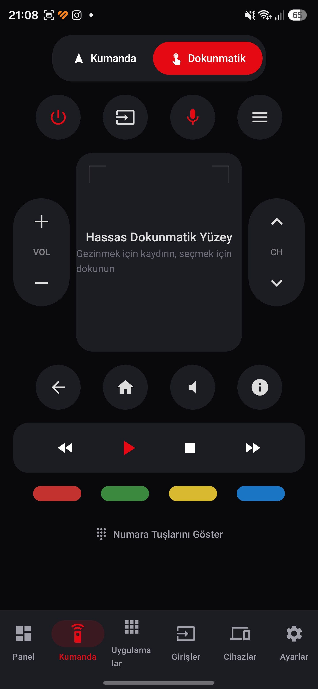
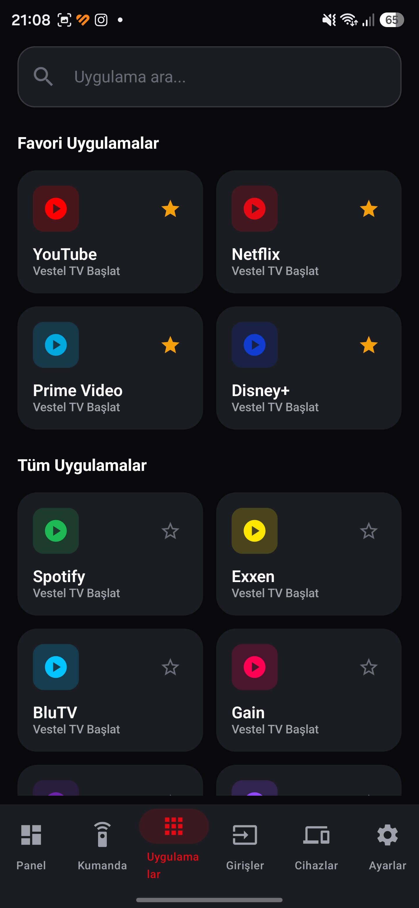

<div align="center">

# 📺 Vestel Remote — Smart Android TV Controller

**A hardware-verified native Android remote control application for the Vestel 55QG9960 4K QLED Android TV and compatible Android TV / Google TV devices over local Wi-Fi.**

[-3DDC84?logo=android&logoColor=white)](https://developer.android.com)
[](https://kotlinlang.org)
[](https://developer.android.com/jetpack/compose)
[](#3-verified-hardware)
[-E30613)](#3-verified-hardware)
[](https://github.com/Terabithia1572/Vestel-Remote-Android/releases)
[](LICENSE)

**Android application development and Vestel Android TV adaptation: [Yunus İNAN](https://github.com/Terabithia1572)**  
Original macOS menu bar reference project: [LGwebOS-menubar — Gabriel Greco](https://github.com/gabrielgreco1/LGwebOS-menubar)

🌐 **Language / Dil:** **[🇹🇷 Türkçe (README.md)](README.md)** | **🇬🇧 English**

---

### 📱 Application Preview (Samsung Galaxy S24 Ultra & Vestel 55QG9960 `GoogleTV7288`)

<table>
  <tr>
    <td align="center" width="33%">
      <br/>
      <b>Home Dashboard</b><br/>
      <sub>Live <code>GoogleTV7288</code> session & real-time protocol log</sub>
    </td>
    <td align="center" width="33%">
      <br/>
      <b>Remote Controller (D-Pad)</b><br/>
      <sub>Tactile D-Pad, volume/channel rockers & media keys</sub>
    </td>
    <td align="center" width="33%">
      <br/>
      <b>Device Management & Discovery</b><br/>
      <sub>mDNS / SSDP discovery & mTLS PIN pairing</sub>
    </td>
  </tr>
</table>

</div>

---

## 📋 Table of Contents

1. [Project Introduction](#1-project-introduction)
2. [Features](#2-features)
3. [Verified Hardware](#3-verified-hardware)
4. [Technology Stack](#4-technology-stack)
5. [Screenshots](#5-screenshots)
6. [Installation Instructions](#6-installation-instructions)
7. [Pairing Instructions](#7-pairing-instructions)
8. [Android Permissions](#8-android-permissions)
9. [Network Requirements](#9-network-requirements)
10. [Architecture](#10-architecture)
11. [Development Setup](#11-development-setup)
12. [Build Instructions](#12-build-instructions)
13. [Testing](#13-testing)
14. [Known Issues](#14-known-issues)
15. [Compatibility Limitations](#15-compatibility-limitations)
16. [Security and Privacy](#16-security-and-privacy)
17. [Open-Source Attribution](#17-open-source-attribution)
18. [Developer Information](#18-developer-information)

---

## 1. Project Introduction

**Vestel Remote** is a native Android smartphone application engineered to discover, pair with, and control **Vestel 55QG9960 4K QLED Android TV** sets and compatible Android TV / Google TV devices over a local Wi-Fi network.

Inspired by the product concepts of Gabriel Greco's macOS [LGwebOS-menubar](https://github.com/gabrielgreco1/LGwebOS-menubar) project, this application was built from the ground up for Android using **Kotlin**, **Jetpack Compose**, **Material 3**, and the **Android TV Remote Service v2 (mTLS / Protobuf)** wire protocol, adapted for Vestel Android TV hardware by **Yunus İNAN**.

This baseline release has been verified on physical hardware using a **Samsung Galaxy S24 Ultra** connected to a physical **Vestel 55QG9960 (`GoogleTV7288`)** television.

---

## 2. Features

- **🔍 Automatic TV Discovery (mDNS & SSDP):** Discovers `_androidtvremote2._tcp` (Android TV Remote v2) and SSDP/DIAL services on the local network, alongside manual IPv4 and MAC address configuration.
- **🔐 PIN-Verified Mutual TLS (mTLS) Pairing:** Performs a full mutual TLS handshake on port `6467` using an Android Keystore hardware-backed 2048-bit RSA client certificate and the 6-character hexadecimal PIN displayed on the TV.
- **📌 Server Certificate Pinning:** Captures and persists the SHA-256 fingerprint of the TV's X.509 certificate during pairing and enforces certificate verification on subsequent port `6466` control sessions.
- **🏠 Home Dashboard:** Displays the connected television (`GoogleTV7288`), model (`Vestel 55QG9960`), active input source, volume bar, quick actions (Home, Back, Google Assistant, Wake-on-LAN, Devices), and a live **Protocol Event Log**.
- **🎮 Full-Featured Remote Controller:**
  - **D-Pad Mode:** Tactile Up, Down, Left, Right, and OK navigation with haptic feedback.
  - **Touchpad Mode:** Swipe and tap gesture surface for fluid navigation.
  - **Volume & Channel Rockers:** Ergonomic vertical `VOL +/-` and `CH +/-` rockers.
  - **System & Media Keys:** Power, Input Source, Google Assistant, Menu, Back, Home, Mute, Info, Rewind, Play/Pause, Stop, Fast Forward.
  - **Color & Number Keys:** Red, Green, Yellow, Blue broadcast keys and a collapsible `0–9` numeric keypad.
- **🚀 Smart TV App Launcher:** Quick launch cards for YouTube, Netflix, Prime Video, Disney+, Spotify, Exxen, BluTV, Gain, TOD, and Twitch, with favorite pinning and instant search.
- **🔌 Input Sources Screen:** Dedicated view for HDMI 1, HDMI 2 (eARC), HDMI 3, Live TV (Satellite/Terrestrial), and AV / Composite inputs.
- **🩺 Privacy-Safe Connection Diagnostics:** One-tap `Copy Diagnostics` button that exports sanitized connection/pairing state transitions without exposing PINs, private keys, certificates, or pairing secrets.
- **⚙️ Settings & Virtual TV Mock Mode:** Bilingual UI (Turkish / English), Pure AMOLED Dark / Light theme, haptic feedback toggle, and a Virtual TV Mock Mode for testing UI flows without a physical television.

---

## 3. Verified Hardware

This release (`v1.0.0-beta.1`) has been tested and confirmed working end-to-end on real physical devices:

| Component | Verified Device / Model | Status |
| :--- | :--- | :--- |
| **Smartphone** | **Samsung Galaxy S24 Ultra** (Dynamic AMOLED 2X, 1440×3120, One UI) | ✅ Verified |
| **Television** | **Vestel 55QG9960 4K QLED Android TV** (Advertised as `GoogleTV7288`) | ✅ Verified |
| **TV Discovery** | Local Wi-Fi mDNS / SSDP discovery of `GoogleTV7288` | ✅ Verified |
| **Pairing** | Port `6467` mTLS handshake & 6-digit on-screen PIN verification | ✅ Verified |
| **Authenticated Session** | Port `6466` `RemoteConfigure` → `RemoteSetActive` → `RemoteStart` session | ✅ Verified |
| **Main Remote Controls** | D-Pad navigation, OK, Back, Home, Volume +/-, Mute, Power & control screens | ✅ Verified |

---

## 4. Technology Stack

- **Language:** Kotlin `2.0.21` (JVM Target 17)
- **UI Toolkit:** Jetpack Compose (BOM `2024.10.01`) & Material 3
- **Architecture:** Clean Architecture + MVVM (`StateFlow`, `ViewModel`, Kotlin Coroutines `1.9.0`)
- **Navigation:** AndroidX Navigation Compose `2.8.3`
- **Persistence:** AndroidX DataStore Preferences `1.1.1`
- **Cryptography & Security:**
  - Android Keystore (`RSA 2048-bit` with `DIGEST_NONE`, `SHA-256/384/512`, `PKCS#1`, and `RSA-PSS` support for Conscrypt/TLS)
  - Custom `X509ExtendedKeyManager` and SHA-256 fingerprint-pinning `X509TrustManager`
- **Network Protocols:**
  - Android TV Remote Service v2 (TLS Ports `6466` & `6467`, varint-framed Protobuf)
  - DIAL REST (HTTP Port `8008`)
  - mDNS / Android `NsdManager` (`_androidtvremote2._tcp`) & SSDP (`239.255.255.250:1900`)
  - Wake-on-LAN (UDP Port `9` Magic Packet)
- **Build System:** Gradle `8.14` (Kotlin DSL) & Android Gradle Plugin `8.8.0`
- **SDK Levels:** `minSdk = 26` (Android 8.0) / `targetSdk = 35` (`compileSdk = 35`, Android 15)

---

## 5. Screenshots

All screenshots below were captured on a **Samsung Galaxy S24 Ultra** actively paired and connected to the physical **Vestel 55QG9960 (`GoogleTV7288`)** television (the last octet of the private LAN IP is redacted as `192.168.1.XXX` for privacy):

<table>
  <tr>
    <td align="center" width="25%">
      <br/>
      <b>1. Dashboard</b><br/>
      <sub>Live connection card, volume bar, quick actions & protocol event log</sub>
    </td>
    <td align="center" width="25%">
      <br/>
      <b>2. Remote (D-Pad)</b><br/>
      <sub>D-Pad navigation, volume/channel rockers, media & color keys</sub>
    </td>
    <td align="center" width="25%">
      <br/>
      <b>3. Remote (Touchpad)</b><br/>
      <sub>Precision swipe-and-tap touchpad navigation mode</sub>
    </td>
    <td align="center" width="25%">
      <br/>
      <b>4. Apps Launcher</b><br/>
      <sub>Favorite streaming apps, search filter & quick launch</sub>
    </td>
  </tr>
  <tr>
    <td align="center" width="25%">
      <br/>
      <b>5. Input Sources</b><br/>
      <sub>HDMI 1, HDMI 2 (eARC), HDMI 3, Live TV & AV selection</sub>
    </td>
    <td align="center" width="25%">
      <br/>
      <b>6. Devices</b><br/>
      <sub>Discovered TVs (<code>GoogleTV7288</code>), saved devices & manual IP</sub>
    </td>
    <td align="center" width="25%">
      <br/>
      <b>7. Settings</b><br/>
      <sub>Language, AMOLED theme, haptic feedback & diagnostics export</sub>
    </td>
    <td align="center" width="25%">
      <br/>
      <b>8. About & Attribution</b><br/>
      <sub>Version details, developer attribution & open-source notices</sub>
    </td>
  </tr>
</table>

---

## 6. Installation Instructions

### Option 1: Install Pre-Built APK from GitHub Releases
1. Download the latest `.apk` asset from the **[Releases](https://github.com/Terabithia1572/Vestel-Remote-Android/releases)** page onto your Android smartphone.
2. Open the downloaded APK file and allow installation from unknown sources if prompted.

### Option 2: Install via ADB (Android Debug Bridge)
With **USB Debugging** enabled on your phone, run:
```powershell
adb install -r app\build\outputs\apk\debug\app-debug.apk
```

---

## 7. Pairing Instructions

1. **Connect to the Same Wi-Fi Network:** Ensure your Samsung Galaxy S24 Ultra (or Android phone) and your Vestel 55QG9960 TV are connected to the same local Wi-Fi network.
2. **Power On the TV:** Turn on the television using its physical remote and keep it awake.
3. **Open the Devices Tab:** Navigate to the **Devices (Cihazlar)** tab on the bottom navigation bar (ensure *Developer Mode / Virtual TV Test* is turned off in Settings).
4. **Discover the TV:** Tap **"Scan Network (mDNS / SSDP)"**. Your TV (e.g., `GoogleTV7288`) will appear under discovered televisions. If your router blocks multicast traffic, enter the TV's IPv4 address manually.
5. **Initiate Pairing:** Tap **"Pair (Eşleştir)"** on the TV card.
6. **Enter the 6-Digit PIN:** A 6-character hexadecimal pairing code will appear on your Vestel TV screen. Enter this code into the pairing dialog on your phone and tap **Confirm (Onayla)**.
7. **Control Your TV:** Once the status transitions to **ACTIVE / Connected**, switch to the **Dashboard** or **Remote** tab to control your TV. Subsequent sessions reconnect directly using the pinned certificate without requiring a new PIN.

---

## 8. Android Permissions

The application requests only the minimal permissions required for local network communication and tactile feedback (`app/src/main/AndroidManifest.xml`):

| Permission | Purpose |
| :--- | :--- |
| `android.permission.INTERNET` | Communicates with the TV over local TLS (`6466`/`6467`), HTTP DIAL (`8008`), and UDP sockets. |
| `android.permission.ACCESS_NETWORK_STATE` | Checks active local network connectivity. |
| `android.permission.ACCESS_WIFI_STATE` | Verifies Wi-Fi connection status for LAN discovery. |
| `android.permission.CHANGE_WIFI_MULTICAST_STATE` | Acquires a multicast lock during mDNS (`_androidtvremote2._tcp`) and SSDP discovery scans. |
| `android.permission.VIBRATE` | Provides tactile haptic feedback when pressing remote control buttons. |

> The application does **not** request camera, microphone, location, contacts, or external storage permissions.

---

## 9. Network Requirements

- The smartphone and television must share the same local subnet with **AP / Client Isolation disabled** on the router.
- Required local ports:

| Port | Protocol | Service | Description |
| :--- | :--- | :--- | :--- |
| **6466** | TCP / TLS | Android TV Remote Control v2 | Authenticated remote control session, key injection, volume & state updates |
| **6467** | TCP / TLS | Android TV Remote Pairing v2 | Mutual TLS certificate exchange and 6-digit PIN verification |
| **8008** | TCP / HTTP | DIAL (Discovery & Launch) | Application launch and status requests |
| **5353** | UDP | mDNS / DNS-SD | Automatic `_androidtvremote2._tcp.local.` service discovery |
| **1900** | UDP | SSDP / UPnP | Local UPnP / DIAL device discovery |
| **9** | UDP | Wake-on-LAN (WoL) | Wakes the TV from standby via UDP Magic Packet |

---

## 10. Architecture

The codebase follows **Clean Architecture + MVVM** with reactive `StateFlow` state management:

```text
app/src/main/java/com/yunusinan/vestelremote/
├── MainActivity.kt                  # Single-Activity Compose entry point & bottom navigation
├── data/
│   ├── crypto/
│   │   ├── CertificateHelper.kt     # Android Keystore 2048-bit RSA & X.509 certificate generator
│   │   ├── PairingCrypto.kt         # SHA-256(ClientMod||ClientExp||ServerMod||ServerExp||PIN)
│   │   └── TlsSocketFactoryHelper.kt# mTLS KeyManager & SHA-256 certificate-pinning TrustManager
│   ├── datastore/
│   │   └── PreferencesManager.kt    # Persisted devices, pinned fingerprints & user preferences
│   ├── protocol/
│   │   ├── AndroidTvRemoteV2Client.kt # Port 6467 pairing & Port 6466 live remote session
│   │   ├── RemoteProtocol.kt        # Polo/Remote v2 state machines & strict frame validators
│   │   ├── ProtoUtils.kt            # Lightweight varint-framed Protobuf encoder/decoder
│   │   ├── TvDiscoveryManager.kt    # NsdManager (mDNS) and SSDP discovery manager
│   │   ├── DialClient.kt            # Port 8008 DIAL application launcher
│   │   ├── WakeOnLan.kt             # UDP Magic Packet broadcaster
│   │   ├── AttemptDiagnostics.kt    # Privacy-safe connection attempt diagnostic recorder
│   │   └── MockTvClient.kt          # Virtual TV simulator for hardware-free testing
│   └── repository/
│       ├── TvRepository.kt          # Domain-Data contract
│       └── TvRepositoryImpl.kt      # Session, discovery & persistence orchestration
├── domain/model/                    # TvDevice, TvCommand, ConnectionStatus, ProtocolEvent, etc.
└── ui/
    ├── components/                  # DPadControl, TouchpadControl, VolumeRockers, PairingDialog, etc.
    ├── screens/                     # Dashboard, Remote, Apps, Inputs, Devices, Settings screens
    ├── theme/                       # AMOLED Black & Vestel Red Material 3 theme
    └── viewmodel/MainViewModel.kt   # Single source of truth (StateFlow) & UI event handlers
```

Additional technical documentation is available in `docs/`:
- [Architecture Design (`docs/ARCHITECTURE.md`)](docs/ARCHITECTURE.md)
- [Protocol Research (`docs/PROTOCOL_RESEARCH.md`)](docs/PROTOCOL_RESEARCH.md)
- [Pairing Audit & Repair Report (`docs/PAIRING_AUDIT_20261017_TR.md`)](docs/PAIRING_AUDIT_20261017_TR.md)
- [Compatibility Matrix (`docs/COMPATIBILITY.md`)](docs/COMPATIBILITY.md)

---

## 11. Development Setup

1. **Prerequisites:**
   - **JDK 17** or **JDK 21** (Android Studio JBR recommended)
   - **Android SDK Platform 35** and Build-Tools
2. **Clone the Repository:**
   ```powershell
   git clone https://github.com/Terabithia1572/Vestel-Remote-Android.git
   cd Vestel-Remote-Android
   ```
3. **Android SDK Configuration:**
   Opening the project in Android Studio automatically generates `local.properties` (excluded from Git via `.gitignore`).

---

## 12. Build Instructions

To build the installable Debug APK on Windows PowerShell:

```powershell
.\gradlew.bat assembleDebug
```

On macOS / Linux:

```bash
./gradlew assembleDebug
```

The generated APK is written to:
```text
app/build/outputs/apk/debug/app-debug.apk
```

---

## 13. Testing

The repository includes **33 unit and regression tests** covering Protobuf framing, SHA-256 PIN cryptography, pairing state machine validation, real loopback mTLS socket sessions, truncated/malformed frame rejection, and secret-redaction checks.

Run the test suite with:

```powershell
.\gradlew.bat testDebugUnitTest
```

Test suites (`app/src/test/java/com/yunusinan/vestelremote/protocol/`):
- `ProtoUtilsTest` — Varint and frame boundary tests
- `PairingCryptoTest` — RSA modulus/exponent & PIN SHA-256 secret vector tests
- `PairingStateMachineTest` — Pairing ACK and error state transition tests
- `ReferenceProtocolTest` — Official Android TV Remote v2 wire schema compatibility tests
- `RemoteSessionRegressionTest` — Loopback mTLS, certificate pinning, `RemoteStart`, ping/volume, and cancellation tests
- `TvCommandEncodingTest` — Android `KeyEvent` keycode verification tests
- `MockTvClientTest` — Virtual TV state machine tests

---

## 14. Known Issues

Following real-device verification (**Samsung Galaxy S24 Ultra** ↔ **Vestel 55QG9960 `GoogleTV7288`**), core discovery, pairing, authenticated connection, and remote navigation are confirmed working. The following known issues are scheduled for the next development phase:

1. **Dashboard Volume Slider Instability:**
   - The volume slider on the Home Dashboard behaves unstably. Volume commands may continue after the user releases the slider, making it difficult to stop the volume at the desired level. *(Workaround: Use the vertical `VOL + / -` rocker buttons on the Remote screen, which work reliably.)*
2. **Dynamic Installed-App Discovery on the Apps Screen:**
   - The `Apps` screen currently displays a curated catalog of streaming services. Dynamic discovery and listing of applications actually installed on the television (where permitted by the supported protocol) is planned for the next development phase.

---

## 15. Compatibility Limitations

- **Supported Televisions:** Vestel 55QG9960 and other Vestel-manufactured televisions running **Android TV** or **Google TV** with `Android TV Remote Service v2` (`_androidtvremote2._tcp`) enabled.
- **Unsupported Legacy Models:** Non-Android Vestel Smart Center televisions (Linux-based MB90, MB100, MB130, MB211 boards) use a different proprietary protocol and are not supported.
- **DHCP IP Changes:** If the router assigns a new IPv4 address to the TV via DHCP, re-scanning on the Devices tab may be required.

---

## 16. Security and Privacy

- **100% Local Network Operation:** No telemetry, analytics, or cloud servers are contacted. All traffic stays strictly on the user's local Wi-Fi network.
- **Hardware-Backed Client Identity:** The client RSA private key is generated inside the Android Keystore and never leaves secure storage.
- **Sanitized Diagnostics:** The in-app `Copy Diagnostics` feature records only connection stage metadata and never logs PIN codes, private keys, raw certificates, or pairing secrets.
- **Repository Hygiene:** No private keys, client certificates, pairing secrets, PIN codes, personal access tokens, keystores, or machine-specific paths are included in this repository.

---

## 17. Open-Source Attribution

- **Original macOS Reference Project:** [LGwebOS-menubar](https://github.com/gabrielgreco1/LGwebOS-menubar) by **Gabriel Greco** (MIT License). Yunus İNAN does not claim authorship of the original macOS application; original copyright notices and the MIT license are preserved in [`LICENSE`](LICENSE) and [`THIRD_PARTY_NOTICES.md`](THIRD_PARTY_NOTICES.md).
- **Android TV Remote v2 Protocol References:**
  - [tronikos/androidtvremote2](https://github.com/tronikos/androidtvremote2) (Apache License 2.0)
  - [louis49/androidtv-remote](https://github.com/louis49/androidtv-remote) (MIT License)
  - [REA Framework (morluto/rea)](https://github.com/morluto/rea) (MIT License)
  - Android Open Source Project (AOSP) Jetpack & Conscrypt (Apache License 2.0)

See [`LICENSE`](LICENSE), [`THIRD_PARTY_NOTICES.md`](THIRD_PARTY_NOTICES.md), and [`docs/THIRD_PARTY_NOTICES.md`](docs/THIRD_PARTY_NOTICES.md) for complete license texts and notices.

---

## 18. Developer Information

- **Developer:** **Yunus İNAN**
- **Attribution:** *Android application development and Vestel Android TV adaptation: Yunus İNAN*
- **GitHub Profile:** [https://github.com/Terabithia1572](https://github.com/Terabithia1572)
- **Repository:** [https://github.com/Terabithia1572/Vestel-Remote-Android](https://github.com/Terabithia1572/Vestel-Remote-Android)

> **Disclaimer:** This project is an independent open-source effort and is not affiliated with, endorsed by, or sponsored by **Vestel Elektronik Sanayi ve Ticaret A.Ş.** or **Google LLC**. *Vestel*, *Android TV*, *Google TV*, and *Samsung Galaxy* are registered trademarks of their respective owners.
