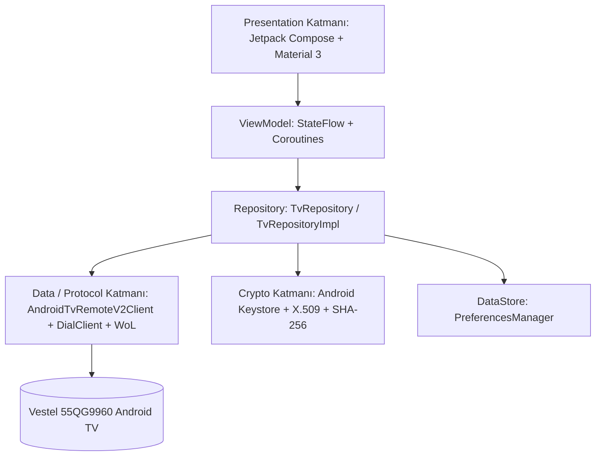
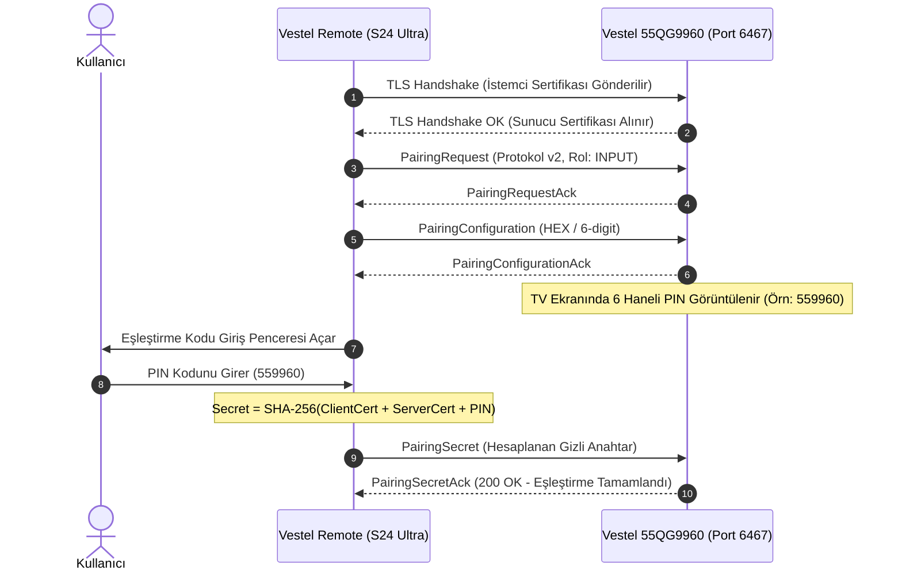
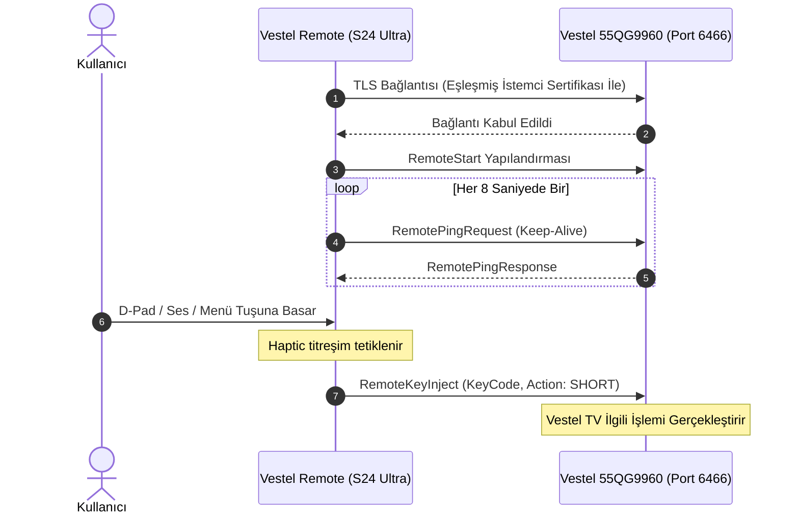

# VESTEL REMOTE — YAZILIM MİMARİSİ VE TASARIM DOKÜMANI

**Uygulama Adı:** Vestel Remote  
**Geliştirici:** Yunus İNAN  
**Hedef Cihaz:** Samsung Galaxy S24 Ultra (Android 14 / One UI 6.1)  
**Hedef Televizyon:** Vestel 55QG9960 Android TV  
**Mimari Desen:** Clean Architecture + MVVM (Model-View-ViewModel)  

---

## 1. MİMARİ GENEL BAKIŞ

Vestel Remote, modüler, test edilebilir ve sürdürülebilir bir Android mimarisi üzerine inşa edilmiştir. Uygulama üç ana katmandan oluşur:

---

## 2. KATMANLAR VE SORUMLULUKLAR

### 2.1 Domain Katmanı (`domain/`)
- **`model/TvDevice.kt`:** Televizyonun IP, MAC, port ve yetenek verilerini saklar.
- **`model/TvCommand.kt`:** TV'ye gönderilecek yön tuşları, ses, medya ve sayısal tuşları tanımlayan sealed class yapısıdır. Android resmi `KeyEvent` kodlarıyla eşleşir.
- **`model/TvApp.kt`:** YouTube, Netflix, Prime Video gibi akıllı TV uygulamalarını ve DIAL/DeepLink bilgilerini tanımlar.
- **`model/TvInput.kt`:** HDMI 1, HDMI 2 (eARC), HDMI 3, Canlı TV ve AV kaynaklarını temsil eder.
- **`model/ConnectionStatus.kt`:** Bağlantı durum makinesini (`Disconnected`, `Scanning`, `Connecting`, `PairingPrompt`, `Connected`, `Standby`, `Error`) modeller.
- **`model/ProtocolEvent.kt`:** Ağ ve protokol etkileşimlerini kullanıcıya ve teşhis araçlarına şeffafça sunan olay günlüğü modelidir.

### 2.2 Data Katmanı (`data/`)
- **`crypto/CertificateHelper.kt`:** Android Keystore kullanarak donanım korumalı 2048-bit RSA anahtar çifti ve öz-imzalı X.509 sertifikası üretir. JVM ortamlarında yazılımsal fallback sağlar.
- **`crypto/PairingCrypto.kt`:** Android TV Remote v2 standardına uygun SHA-256 tabanlı gizli anahtar (PairingSecret) hesaplamasını yapar.
- **`crypto/TlsSocketFactoryHelper.kt`:** İstemci sertifikasını içeren `KeyManager` ve televizyon sertifikasını sabitleyen (pinning) `TrustManager` ile güvenli TLS soketleri açar.
- **`protocol/ProtoUtils.kt`:** Protobuf ikili serileştirme (varint, uzunluk önekli alanlar) işlemlerini gerçekleştiren hafif Kotlin motorudur.
- **`protocol/AndroidTvRemoteV2Client.kt`:** Port 6467 üzerinden eşleştirme ve Port 6466 üzerinden kumanda oturumu yönetimini sağlar.
- **`protocol/DialClient.kt`:** Port 8008 üzerinden HTTP REST çağrıları ile uygulama durumunu sorgular ve başlatır.
- **`protocol/WakeOnLan.kt`:** UDP Port 9 üzerinden sihirli paket yayınlayarak TV'yi bekleme modundan uyandırır.
- **`protocol/TvDiscoveryManager.kt`:** Android `NsdManager` (mDNS `_androidtvremote2._tcp`) ve SSDP (`239.255.255.250:1900`) kullanarak ağdaki TV'leri otomatik keşfeder.
- **`protocol/MockTvClient.kt`:** Fiziksel TV bulunmayan geliştirme ve test ortamlarında tüm bağlantı ve komut döngüsünü simüle eder.
- **`datastore/PreferencesManager.kt`:** Eşleştirilmiş TV'leri, favori uygulamaları, dil ve tema tercihlerini Android Jetpack DataStore ile şifreli/güvenli olarak saklar.

### 2.3 Presentation Katmanı (`ui/`)
- **`viewmodel/MainViewModel.kt`:** Tek gerçek kaynak (Single Source of Truth) olarak `MainUiState` sunar. Dokunsal titreşim (Haptic) efektlerini yönetir.
- **`screens/`:**
  - `DashboardScreen`: Televizyon durum kartı, hızlı kontroller, ses kaydırıcısı ve protokol günlüğü.
  - `RemoteScreen`: D-Pad / Touchpad modları, ses ve kanal mandalları (rockers), medya çubuğu, renk tuşları ve sayısal tuş takımı.
  - `AppsScreen`: Akıllı TV uygulamaları vitrini ve favori sabitleme.
  - `InputsScreen`: HDMI ve Canlı TV kaynak geçişi.
  - `DevicesScreen`: Ağ tarayıcı, manuel IP girişi ve kayıtlı cihaz yönetimi.
  - `SettingsScreen`: Dil, tema, dokunsal geribildirim, donanım kontrol listesi ve Yunus İNAN telif atıfları.

---

## 3. PROTOKOL SIRALAMA DİYAGRAMLARI (SEQUENCE DIAGRAMS)

### 3.1 Eşleştirme (Pairing) Akışı

### 3.2 Kumanda Oturumu ve Tuş İletimi

---

## 4. SAMSUNG GALAXY S24 ULTRA OPTİMİZASYONLARI

1. **Uçtan Uca (Edge-to-Edge) Arayüz:**
   - Android 14/15 pencere insets API'leri (`WindowInsetsCompat.safeDrawing`) kullanılarak kamera deliği (punch-hole) ve kavisli köşeler dikkate alınarak tasarlanmıştır.
2. **AMOLED Siyahı (Pure OLED Black):**
   - Galaxy S24 Ultra'nın Dynamic AMOLED 2X ekranında güç tüketimini sıfırlayan `#09090C` saf siyah arka plan renk paleti kullanılmıştır.
3. **Dokunsal Geribildirim (Haptic Feedback Engine):**
   - Android `VibratorManager` ve `VibrationEffect.createOneShot` ile fiziksel kumanda tuşuna basma hissi veren mikro-titreşimler (18 ms) üretilir.
